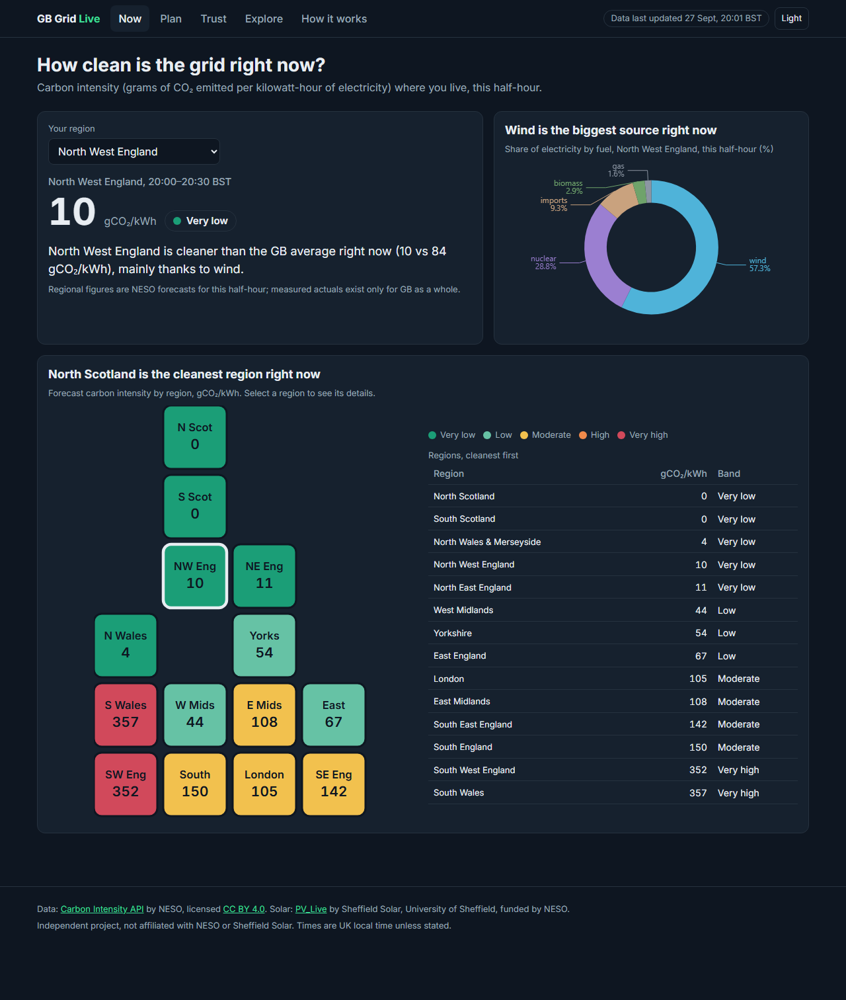
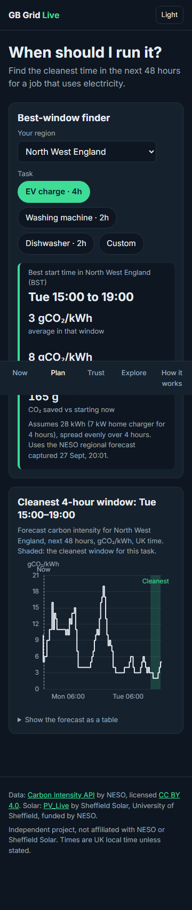
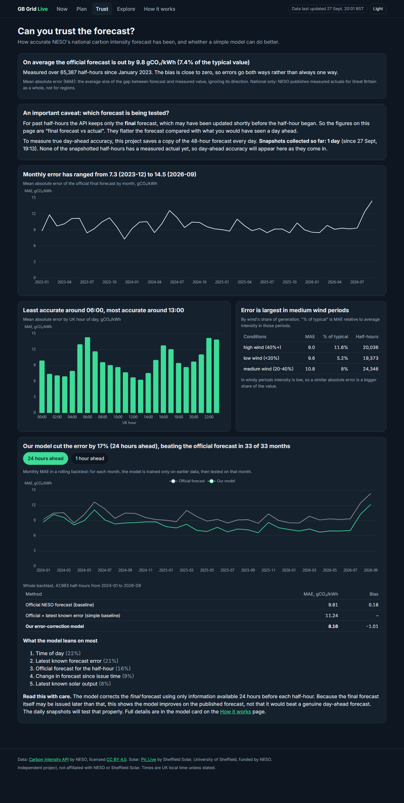
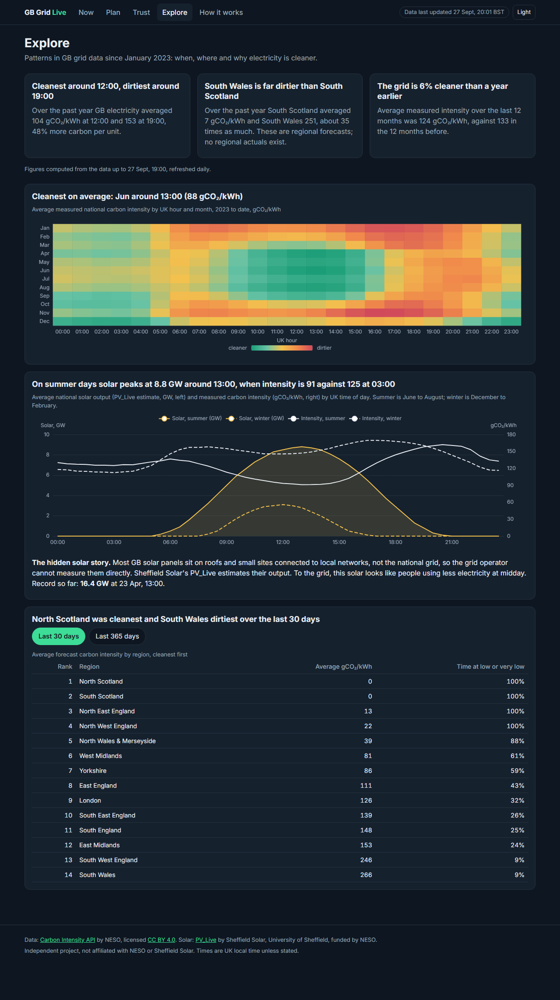

# GB Grid Live

*Use power when the grid is cleanest.*

**Live site: https://swhutchinson.github.io/gb-grid-live/**

GB Grid Live shows how clean electricity is in each region of Great Britain right now, and finds the cleanest time in the next 48 hours to charge a car or run the washing machine. Behind it is a daily data pipeline (Python, DuckDB, dbt) that ingests open data from NESO and Sheffield Solar, tests the data, and publishes a static site through GitHub Actions. It also checks how accurate the official NESO carbon forecast is, and backtests an error-correction model against it honestly.

| Now | Plan (mobile) |
| --- | --- |
|  |  |
| **Trust** | **Explore** |
|  |  |

## How it works

```
Carbon Intensity API ─┐                    dbt (DuckDB)                      LightGBM
PV_Live (solar) ──────┴─> raw JSON ─> bronze ─> silver ─> gold ──> model backtest ─> JSON ─> React site
                         (≤14-day chunks,     (typed)  (deduped,  (one table                  (GitHub Pages)
                          1 request/s)                  UTC)       per chart)
```

- **Runs daily** at 05:30 UTC on GitHub Actions (`.github/workflows/daily.yml`): ingest, snapshot the 48h forecast, `dbt build` with about 80 data tests, model backtest, export, site tests, then deploy.
- **Data quality** is published on the site: gaps in the source data are counted and listed, never filled in.
- **Every non-obvious choice** is in [`docs/DECISIONS.md`](docs/DECISIONS.md); what was built, what broke and how it was fixed is in [`docs/BUILD_LOG.md`](docs/BUILD_LOG.md).
- **`learning/`** has line-by-line commented copies of the key modules.

## Also feeds a Power BI report: GB Battery Watch

The same project now feeds a second product. **GB Battery Watch** (Power BI) answers *"how do we get the most out of a battery?"*: when to charge, when to use the stored power, what that saves, and whether a battery is worth buying.

- `pipeline/battery/` fetches Elexon wholesale prices and day-ahead wind, solar and demand forecasts, forecasts tomorrow's price (LightGBM, backtested honestly against what was known the day before), and runs an exact battery optimiser (a linear programme per day) for 14 regions plus wholesale, 3 battery durations, 3 efficiencies and 3 strategies.
- `.github/workflows/battery.yml` runs it at 06:15 and 17:20 UTC and publishes small CSVs to the `powerbi-data` branch, which Power BI reads from raw.githubusercontent.com with no gateway.
- Run it locally with `python -m pipeline.battery.run` (`--no-fetch` to rebuild from saved state); tests: `python -m pytest -q tests/test_battery.py`.
- Why it is built this way (tariff terms, no free day-ahead price, the optimiser's assumptions) is in [`docs/DECISIONS.md`](docs/DECISIONS.md).

## Setup (Windows, PowerShell)

```powershell
git clone https://github.com/swhutchinson/gb-grid-live.git
cd gb-grid-live
python -m venv .venv
.\.venv\Scripts\Activate.ps1
python -m pip install -r requirements.txt
python -m pipeline.run        # first run backfills from 2023 (~40 minutes, politely rate-limited)
```

Requires Python 3.11+ and Node.js 24 LTS. No API keys or secrets are needed.

## Commands

| Command | What it does |
| --- | --- |
| `python -m pipeline.run` | **The whole pipeline:** backfill (only new or recent chunks), forecast snapshot, `dbt build` (all models and tests) into `data/warehouse.duckdb`, model backtest, then export JSON for the site. Add `--skip-ingest` to rebuild from raw files without calling the APIs. |
| `python -m pipeline.backfill` | Downloads raw data for both sources from 2023-01-01 to the current half-hour, in ≤14-day chunks at no more than one request per second. Safe to stop and rerun: completed chunks are skipped. Options: `--start`, `--end`, `--sources`. |
| `python -m pipeline.snapshot` | Saves the current 48-hour national and regional forecasts with a `captured_at` time (gzipped). |
| `python -m pipeline.model.backtest` | Rolling-origin backtest of the error-correction model. |
| `python -m pipeline.export` | Writes the site's JSON files from the gold tables to `web/public/data/`. |
| `python -m pipeline.summary` | Prints files, rows and date coverage per raw source. |
| `python -m pytest` | Python unit tests (offline; network access is blocked). |

### Website (in `web/`)
```powershell
cd web
npm install
npm run dev          # local development server
npm run build        # production build into web/dist
npm test             # unit tests (best-window finder)
npx playwright install chromium
npm run e2e          # smoke tests against the production build (desktop and 360px)
```

## Data sources and credits
- **Carbon Intensity API**, NESO, CC BY 4.0: https://carbonintensity.org.uk
- **PV_Live**, Sheffield Solar (University of Sheffield), funded by NESO: https://www.solar.sheffield.ac.uk/pvlive/
- **Historic Demand Data**, NESO, NESO Open Data Licence: https://www.neso.energy/data-portal/historic-demand-data
- **Elexon Insights (BMRS)**, wholesale prices and day-ahead forecasts (battery pipeline): Contains BMRS data © Elexon Limited copyright and database right 2026. Licence: https://www.elexon.co.uk/data/balancing-mechanism-reporting-agent/copyright-licence-bmrs-data/

Independent project, not affiliated with NESO, Sheffield Solar, Elexon or any energy supplier.

## Built with Claude Code
The code was written by Claude Code working from a written spec (`docs/spec/SPEC.md`, `docs/spec/DATA.md`, `docs/spec/DESIGN.md`, `docs/spec/PHASES.md`, `docs/spec/ACCEPTANCE.md`) in five phases, each ending with acceptance checks whose evidence is recorded in the build log. Samuel wrote the spec, made the product decisions and reviewed each phase.

## Licence

The code is MIT licensed (see [LICENSE](LICENSE)). The data belongs to its publishers and is used under their licences, credited above.
